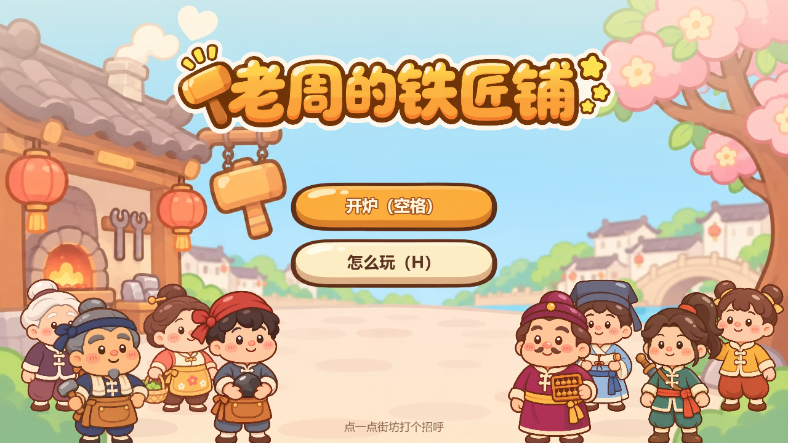
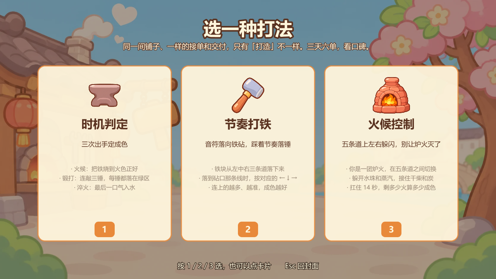
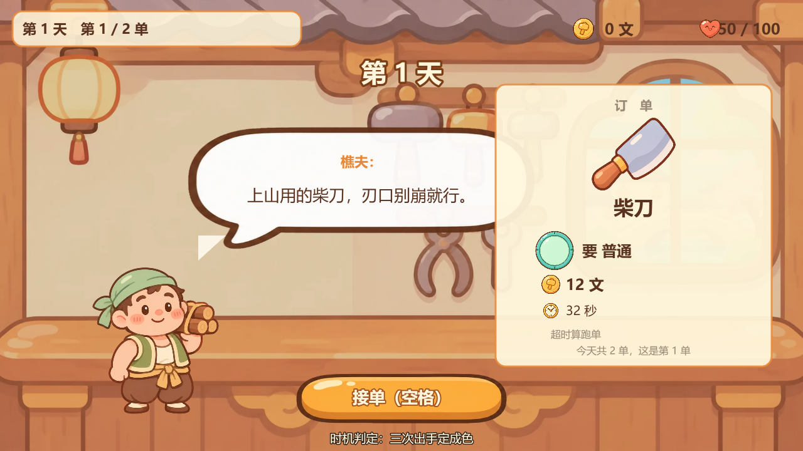
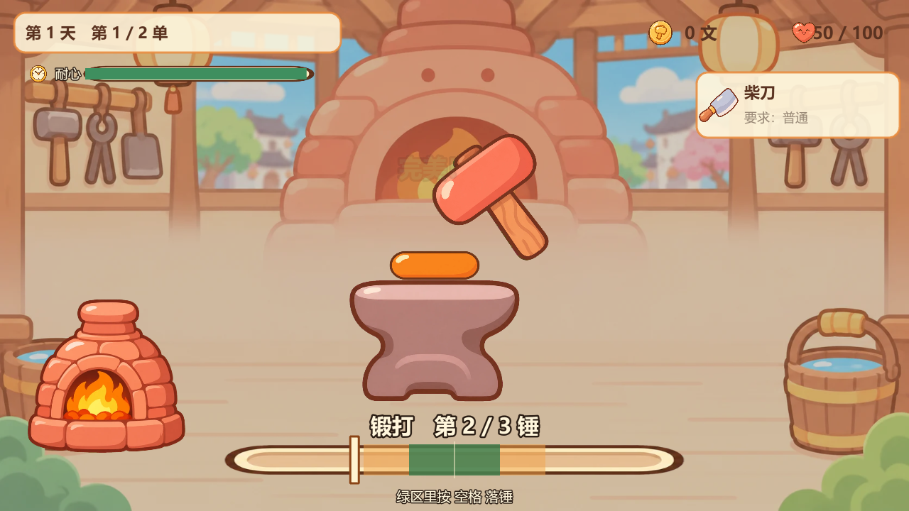
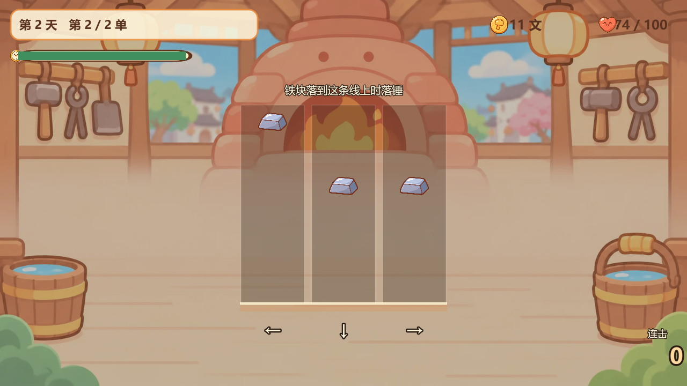
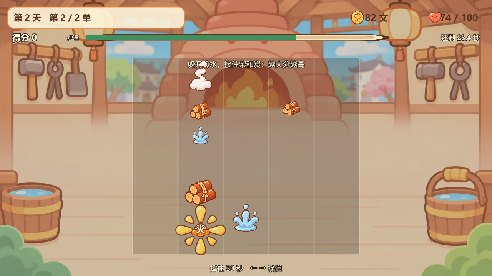
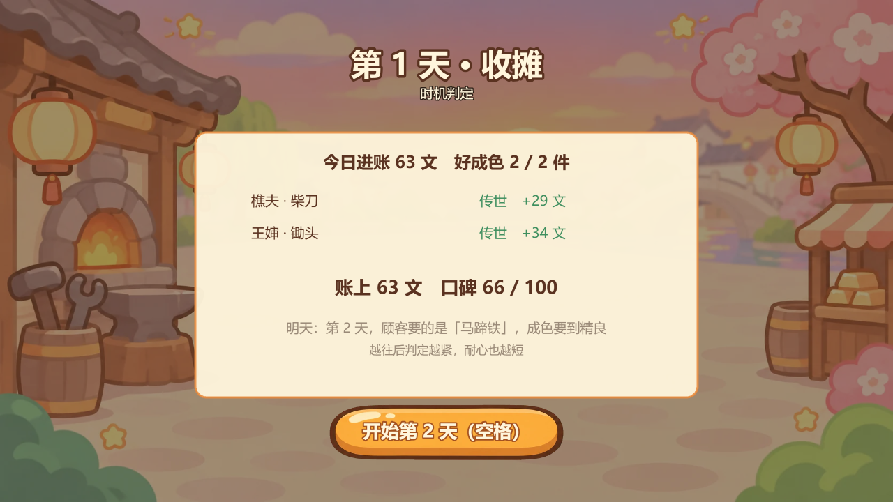
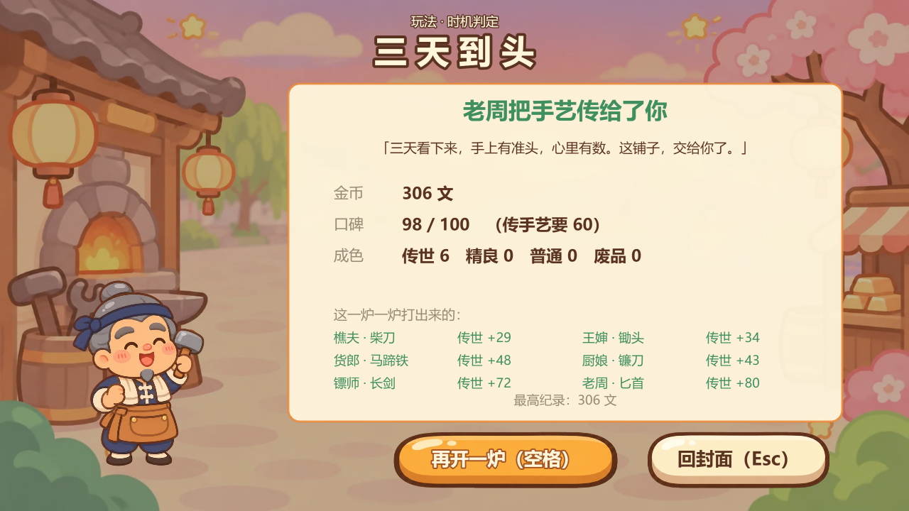

# 老周的铁匠铺

> **组号**：待填　**游戏名**：老周的铁匠铺
>
> | 组员 | 学号 | 提交记录里的用户名 | 负责内容 |
> |---|---|---|---|
> | 待填 | | | |
>
> 同一个小镇铺子，三种打法任选：时机判定 / 节奏打铁 / 火候控制。三天六单，成色决定这一单值多少钱。

## 长什么样

<table>
<tr>
<td></td>
<td></td>
</tr>
<tr>
<td>封面：点街坊有反应，「怎么玩」里写了规则</td>
<td>开局选打法，三种玩法的接单与交付完全一样</td>
</tr>
<tr>
<td></td>
<td></td>
</tr>
<tr>
<td>接单：顾客、气泡、订单卡、今日进度</td>
<td>打法一「时机判定」：绿区里按空格出手三次</td>
</tr>
<tr>
<td></td>
<td></td>
</tr>
<tr>
<td>打法二「节奏打铁」：音符落到砧口线，按 ← ↓ →</td>
<td>打法三「火候控制」：五条道左右躲，别让炉火灭了</td>
</tr>
<tr>
<td></td>
<td></td>
</tr>
<tr>
<td>每关（一天）收摊算账，再进下一天</td>
<td>三天过完，老周看账本和口碑</td>
</tr>
</table>

截图在 `docs/screenshots/`，由 `verify/tour.mjs` 自动走查生成（跑一次会把原始输出写到 `shots/<玩法>/`）。

## 运行

需要 Node.js 22（20.19 以上也行）和 Google Chrome（`npm run shot` 截图自检要用）。

```bash
npm install      # 第一次装依赖
npm run dev      # 打开 http://localhost:5173 ，改代码后自动刷新
npm run check    # 类型检查 + 规则测试（38 项）
npm run shot     # 模板自带的截图自检（按空格走流程）
npm run pack     # 打包成 release/index.html，双击就能玩
```

交作业用的包在 `release/index.html`：图片、代码、声音全部内联在一个文件里，离线双击就能玩。

技术栈：TypeScript + Vite + Phaser 4（2D 网页游戏框架）。

## 玩法说明

**背景**：老周闪了腰，铺子交给你看三天。一天两单，三天后他看账本和口碑，决定传不传手艺。

**核心循环**：接单 → 打造 → 交付 → 推进（下一天更难）→ 三天后结算。

### 三种打法（开局选一个）

| 打法 | 怎么打 | 成色怎么算 |
|---|---|---|
| 时机判定 | 火候 → 三锤 → 淬火，指针进绿区时按空格 | 火候 30% + 三锤 45% + 淬火 25%，每次按完美/不错/落空折算 |
| 节奏打铁 | 铁块从左中右三条道落向砧口线，按 ← ↓ → 落锤；一局约 30 秒 | 所有音符判定（完美 1 / 不错 0.6 / 落空 0.15）的平均分 |
| 火候控制 | 你是一团炉火，← → 在五条道间换位，躲水珠和蒸汽、接干柴和炭；一局 30 秒 | 净得分 ÷ 满分线 |

三种打法用的是同一张订单表、同一套交付结算，所以换玩法不会换剧情，只换「打造」那一段。

**节奏打铁一天比一天难**：落线更快（1.9s → 1.55s → 1.25s）、音符更密（间隔 0.50s → 0.38s）、同时要按两个键甚至三个键的概率也更高（第一天 10% 双键、第三天 32% 双键 + 14% 三键）。

**火候控制靠大小分档**：干柴 +1~+5、木炭 +6~+10（越大分越高、掉得越快），水珠 −1~−5、蒸汽 −6~−10；一次掉落有时会同时落 2~3 个，得在五条道里挑。炉温掉到 0 就提前熄火。

### 成色与报酬

三种玩法的分数尺度不一样，所以各自有一套分数线（`config.ts` 里可以改）：

| 成色 | 时机判定 | 节奏打铁 | 火候控制 | 报酬 |
|---|---|---|---|---|
| 传世 | ≥ 0.87 | ≥ 0.80 | ≥ 0.55 | 2 倍价（超出顾客要求再 ×1.2） |
| 精良 | ≥ 0.66 | ≥ 0.55 | ≥ 0.33 | 1.4 倍 |
| 普通 | ≥ 0.40 | ≥ 0.32 | ≥ 0.16 | 原价 |
| 废品 | 更低 | 更低 | 更低 | 几乎不给钱 |

火候控制的「满分线」是 200 分：接满大部分柴炭、基本不挨浇才够得上传世。

### 三关与输赢

- 三天 = 三关，每关两单；交完当天两单会「收摊」结算一次，再进下一天。
- 每单都有耐心条：节奏和火候一局 30 秒，顾客耐心 42~50 秒，磨蹭太久会跑单。
- 达到顾客要求的成色，口碑 +8；没达到 −8；出废品 −12；顾客等太久算跑单，不给钱还 −10。
- 口碑掉到 0 提前收摊；三天后口碑 ≥ 60 才算把手艺传给你。
- 难度按天收紧：第二、三天判定窗口更窄（节奏打铁的音符更快、火候掉得更凶），顾客耐心也更短。第三天最后一单是老周自己要的匕首，要求传世。

## 项目结构与文件分工

游戏分三层，每层只做自己的事（给 AI 的项目说明见 `AGENTS.md`）：

| 位置 | 作用 |
|---|---|
| `src/core/game.ts` | 游戏状态、订单表、交付结算、关卡推进、结算汇总。纯逻辑 |
| `src/core/forge.ts` | 时机玩法的判定与品质分、成色、报酬、口碑。纯逻辑 |
| `src/core/modes.ts` | 三种玩法的元信息、节奏分与火候分的折算。纯逻辑 |
| `src/config.ts` | 所有数值：判定窗口、指针速度、成色阈值、三种玩法各自的参数、六张订单 |
| `src/scenes/mode.ts` | 开局选打法 |
| `src/scenes/shop.ts` | 接单：顾客、气泡、订单卡、今日进度 |
| `src/scenes/forge.ts` | 打法一：火候 / 三锤 / 淬火 |
| `src/scenes/rhythm.ts` | 打法二：三条道的节奏打铁 |
| `src/scenes/heat.ts` | 打法三：五条道的火候控制 |
| `src/scenes/dayend.ts` | 每关（每天）的收摊结算 |
| `src/scenes/result.ts` | 三天结束的总结算 |
| `src/scenes/common.ts` | 共用：顶部状态条、订单面板、交付弹层、飘字、徽章 |
| `src/audio/bgm.ts` | 背景音乐（WebAudio 现场合成，素材包里没有音频文件） |
| `src/engine/`、`src/main.ts`、`tools/` | 框架：素材加载、合成音、存档、截图与打包脚本（没改） |
| `tests/core.test.ts` | 规则测试：判定、品质、三种玩法折算、报酬、推进、三关走法、存档、机器人对打 |
| `verify/tour.mjs` | 开发自检：连上本机 Chrome，选一种玩法完整玩一遍并逐阶段截图 |

## 调手感

全在 `src/config.ts`：

- `forge.difficulty`：时机玩法的三阶段窗口，按天分三档。
- `forge.speed`：时机玩法的指针速度。
- `modes.rhythm`：`days` 里按天分别调落线时间、音符间隔、双键/三键概率；判定窗口、三条道间距。
- `modes.heat`：几条道、撑多久、掉落间隔与同时掉落概率、大小对应的宽度和落速、炉温的起点/衰减/扣减、分数线的满分值。
- `forge.grade`：传世 / 精良 / 普通的分界线（三种玩法共用）。
- `pay.multiplier`、`pay.rep`：钱和口碑的力度。
- `orders`：六张订单的顾客、器型、要求、报价、耐心。改这里就是改关卡。

## 素材来源与许可清单

| 素材 | 来源或 AI 工具 | 许可 | 是否修改过 |
|---|---|---|---|
| 180 张图（背景、角色立绘、物品、工具、特效、UI、图标、材料、地块、怪物） | 课程素材包，索引见 `assets/ASSETS.md`，画风与提示词见 `assets/STYLE.md` | 供课程项目使用、修改；需注明来源和生成工具 | 只做缩放、裁切和叠放，未改画 |
| 按钮、面板、徽章等界面件 | 同上课件包（衍生自 Kenney UI Pack 2.0） | CC0 1.0 | 否 |
| 9 种音效（敲打、落空、淬火、收钱、交付、废品、点击、节拍） | 本项目自写配方，WebAudio 现场合成（`src/engine/synth.ts`） | 项目自产 | — |
| 背景音乐 | 本项目自写，WebAudio 现场合成（`src/audio/bgm.ts`） | 项目自产 | — |

素材包里没有音频文件，所以声音全部是代码合成的：好处是打包后单文件离线可用、不占体积，也避免版权问题；代价是音色比录音素材简单。

## AI 创作日志

| 环节 | 工具 | 用 AI 做了什么 | 人的判断和修改 |
|---|---|---|---|
| 选型与游戏卡 | DSH | 读学生任务书和四份参考框架，比较四条参考路线，起草 `GAME_CARD.md` | 定了「一种输入、规则能测、手感能调」的方向；砍掉定价采购，三小时做不完 |
| 规则内核 | DSH | 写 `core/forge.ts`、`core/game.ts`：判定窗口、品质分、成色、报酬与口碑、订单推进 | 要求规则不许碰画面（便于写测试）；把数值全部提到 `config.ts` |
| 三种打法 | DSH | 把「打造」抽成一个分数：时机/节奏/火候各自算分再交给结算；写 `modes.ts` 和三个场景 | 要求共用同一套接单、交付、关卡，换玩法不换剧情；节奏和火候的判定窗口反复调过 |
| 关卡节奏 | DSH | 加了「收摊」关卡结算（`dayend.ts`），三天三关、每关两单 | 因为三小时太长，中间必须给一个「这一关过了」的反馈 |
| 音乐与音效 | DSH | 素材包没有音频，写 `bgm.ts` 用 WebAudio 合成五声音阶循环 | 保留「有真文件就放文件」的分支 |
| 自动走查 | DSH + Chrome | 写 `verify/tour.mjs`：选玩法、按各自规则自动出手、逐阶段截图、抓控制台报错 | 走查发现气泡压卡片、锤子悬空、双水桶、节奏玩法 HUD 挤在一起等问题，逐个改 |

完整记录在 `ai-logs/`。

## 已知限制

- 音效和背景音乐都是合成的，音色简单；想换真素材，把文件放进 `assets/sounds/`、在 `manifest.json` 登记同名 ID 即可。
- 没有做 AI 原生加分项（模型 Key 课上才发）。
- 手感的数值是初值，还没经过真人试玩；`config.ts` 里改一个数字就能重调。
- 三种玩法的难度曲线是按自动走查调出来的，真人玩起来的感受还得再校准；火候控制的分数线和密度最可能需要微调。
- 存档只存「打到一半的这一局」，不存历史战绩。
